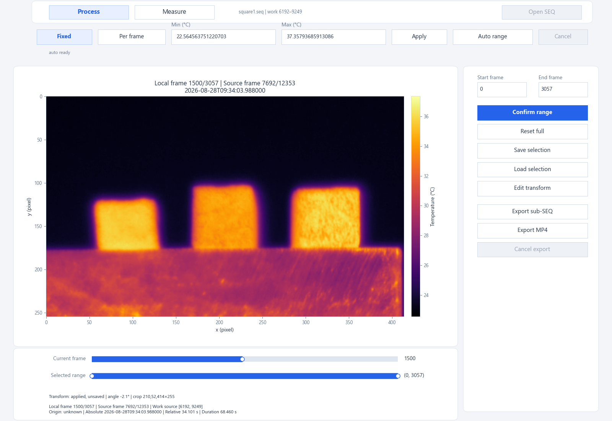
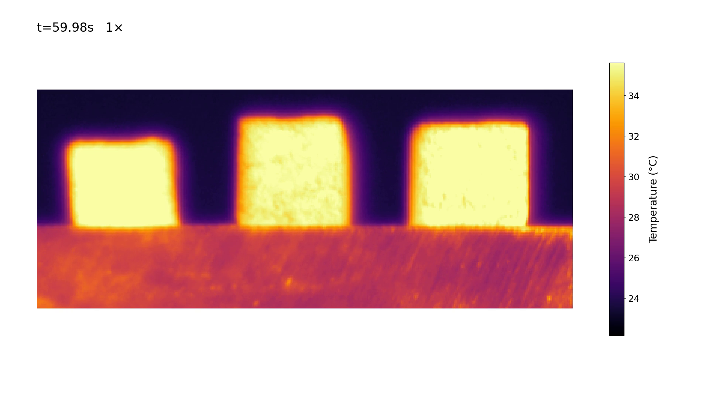
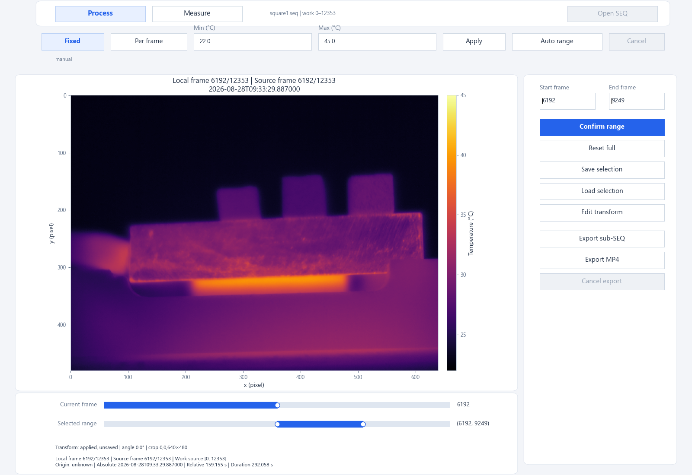
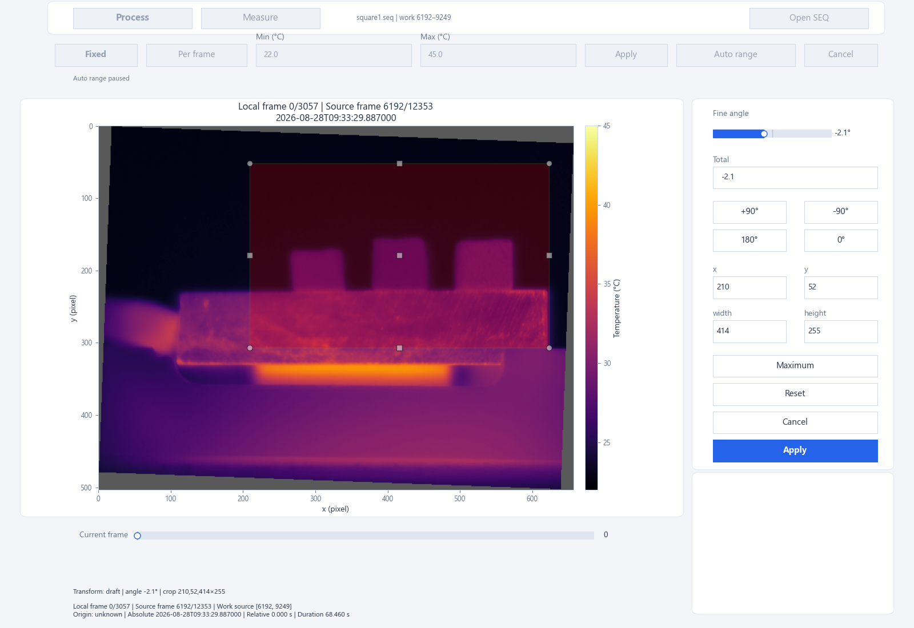
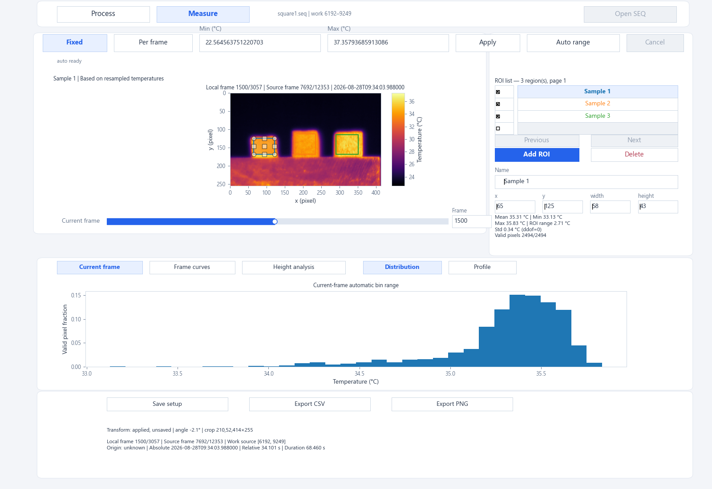
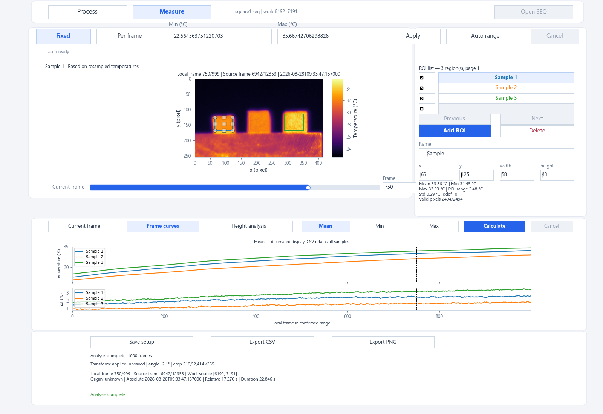
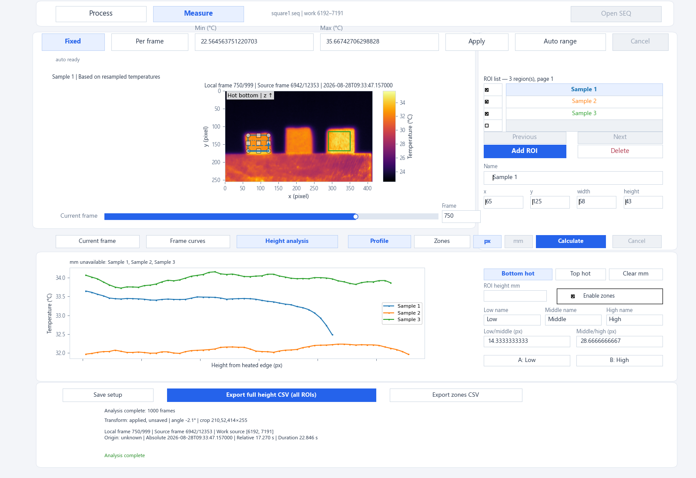
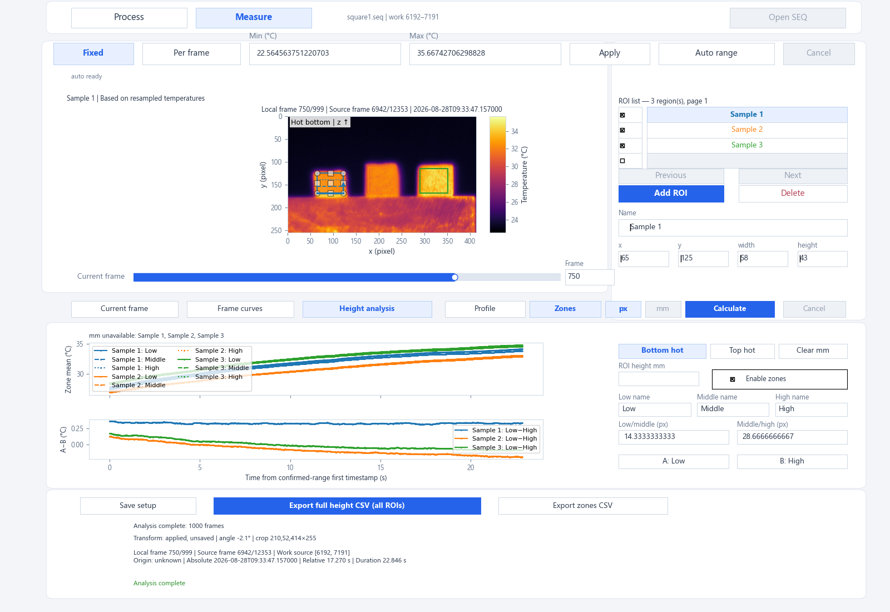

# FLIR SEQ Tool

[简体中文](README.md) | **English**

A local tool for inspecting FLIR ResearchIR FFF `.seq` infrared recordings, viewing temperatures, rotating and cropping images, and analyzing rectangular regions of interest (ROIs). It reads temperatures in degrees Celsius frame by frame through the official FLIR Science File SDK, with two pages: **Process** for preprocessing and **Measure** for analysis.

The tool does not load an entire SEQ recording into memory. You can select a working time range from a long recording, compare temperatures within regions, and export data for further analysis.

[Download the Windows portable package](https://github.com/hbn2333/flir-seq-tool/releases/tag/portable-preview-2026.11.14) · [Quick start](#quick-start) · [Install from source](#install-from-source) · [Changelog](CHANGELOG.md)

## Preview



*The current Process page. Browse the temperature field on the left; select the frame range, edit rotation and cropping, and export on the right. The top controls switch between fixed and per-frame color scales. The interface screenshots in this guide were saved directly from the current application's canvas while reading a real SEQ recording. They exclude operating-system window borders.*

<details>
<summary>View an example MP4 export</summary>

This exported infrared video shows three samples, with rotation and cropping applied, a fixed color scale, relative time, and playback speed.

[](docs/videos/square-0-6287.mp4)

[View or download the full MP4](docs/videos/square-0-6287.mp4) · 1920×1080 · 30 fps · 1× · approximately 2 min 16 s / 22 MB

The `t` value at the upper left comes from the source SEQ frame timestamps, with zero at the first frame of the export range. The color bar on the right is in degrees Celsius. The video illustrates changes in the temperature field; use SEQ and CSV files for quantitative analysis.

</details>

## Features

- Inspect image dimensions, frame counts, timestamps, and timestamp continuity.
- Select a working frame range; use an automatically determined fixed color scale, a manual fixed scale, or a per-frame adaptive scale; rotate and crop the display and analysis view.
- Save and load processing configurations and multiple rectangular ROIs.
- Inspect the current frame's mean, minimum, maximum, temperature range, standard deviation, temperature distribution, and horizontal or vertical profiles.
- Calculate ROI temperature and within-ROI temperature-range curves over time.
- Calculate row-mean temperatures $T(z,t)$ along ROI height, with separate millimeter calibration for each ROI, a heated edge at the top or bottom, and optional low/middle/high zones.
- Switch recordings in the same window with `Open SEQ`.
- Export CSV, PNG, presentation MP4 videos, and native SEQ subsets with matching view-configuration files.

Individual measurement points, an experimental heating-start time origin, and time alignment with external sensors are not currently supported.

This guide covers the 2026.11.14 portable preview, including height analysis, switching recordings in one window, the new color-scale modes, and the large-image Process layout.

## Environment and installation

The verified environment is **Windows x64, Python 3.13.5, and FLIR Science File SDK 2026.1.2**.

### Windows portable folder package (prerelease)

Windows 10/11 x64 users can download the portable folder package. It bundles Python, Tk, scientific libraries, the SDK runtime, and FFmpeg, so users do not need to install Git or Python or configure an environment manually.

1. Download `FLIR_SEQ_Tool-portable-preview-win64.zip` from the Release page.
2. Extract the complete archive to a writable location, keeping the entire `FLIR_SEQ_Tool` folder.
3. Double-click `FLIR_SEQ_Tool.exe` and choose your SEQ recording, or drag one SEQ file onto the EXE.
4. Preprocess in Process, then analyze in Measure. Use `Open SEQ` at the top to switch recordings.

By default, results are written to `output/clips`, `output/analysis`, and `output/selections` inside the application folder. Temporary files and logs go to `cache` and `logs`. Keep the entire folder in a writable location; moving only the EXE will not work. Original recordings are not distributed with the package.

[Download the Windows x64 portable preview (2026.11.14)](https://github.com/hbn2333/flir-seq-tool/releases/tag/portable-preview-2026.11.14). This version has passed automated diagnostics and local user trials on the development machine. Validation on a separate clean computer is still pending. Older attachments remain in the Release history.

The FLIR SDK is a proprietary third-party dependency. Making this repository public does not grant an open-source license to the SDK. Ambiguities in SDK redistribution terms, the corresponding FFmpeg source, and other distribution materials still require verification; prereleases remain subject to third-party licenses. See [Portable build and acceptance](docs/PORTABLE.md) (in Chinese).

For normal use, download the portable ZIP attached to the Release and extract it completely. GitHub's automatically generated `Source code.zip` contains source code and still requires the development setup below.

### Install from source

#### 1. Obtain the official SDK

Obtain and install FLIR Science File SDK and its official Python wheel matching your Python version and architecture. The verified wheel targets CPython 3.13 / x64 (`cp313`). The SDK, wheel, and experimental SEQ recordings are not included in the repository. Obtain and use them according to FLIR's license and installation instructions.

#### 2. Clone the repository and create an environment

Run these commands in PowerShell. You may clone the repository into a directory of your choice.

```powershell
git clone https://github.com/hbn2333/flir-seq-tool.git
cd flir-seq-tool

py -3.13 -m venv .venv
.\.venv\Scripts\python.exe -m pip install --upgrade pip setuptools
```

Install the official wheel using the virtual environment's Python. The wheel path below is a placeholder: replace it with the actual path and filename of your official wheel.

```powershell
.\.venv\Scripts\python.exe -m pip install "C:\path\to\official-filesdk-cp313-wheel.whl"
.\.venv\Scripts\python.exe -m pip install -e .
```

NumPy, SciPy, and Matplotlib are declared as project dependencies and installed with the project. The official SDK must be installed separately. Native file dialogs also require a working Tkinter installation.

For MP4 export from a source installation, FFmpeg must be available on `PATH` with the `libx264` encoder. Check with `ffmpeg -version` and `ffmpeg -encoders`. The program does not download or install FFmpeg automatically, and does not require ffprobe. Other features do not require FFmpeg.

#### 3. Check the environment

```powershell
.\.venv\Scripts\python.exe -c "import fnv.file, tkinter, flir_seq_tool; print('Imports OK')"
.\.venv\Scripts\python.exe -m flir_seq_tool --help
```

Successful imports confirm that the Python modules are available. Use your own SEQ recording to verify SDK reading as well.

The default working root is determined by the installation location, independently of the terminal's current directory: the repository root for a source checkout, or `output` beside the EXE for the portable package. Save As dialogs allow other destinations. The tool protects the current source file, aliases referring to it, the project's `raw` directory, and any ancestor directory named `raw` in the source file's path. It does not automatically make every other data directory read-only. Keep outputs separate from original data and retain backups of your originals.

## Quick start

Portable-package users can open the EXE and follow the workflow below. Source users can also launch from the command line. Run the following commands in the repository directory using the same Python environment in which you installed the SDK. Replace the example recording path with your own.

```powershell
# Inspect basic metadata
.\.venv\Scripts\python.exe -m flir_seq_tool inspect "C:\data\experiment.seq"

# Open the viewer
.\.venv\Scripts\python.exe -m flir_seq_tool view "C:\data\experiment.seq"

# Optional: start with a manual fixed color scale (degrees Celsius)
.\.venv\Scripts\python.exe -m flir_seq_tool view "C:\data\experiment.seq" --vmin 20 --vmax 45
```

With that environment activated, you can also use `python -m flir_seq_tool` or the installed `flir-seq` command.

Recommended workflow:

1. **Process**: select a time range → `Confirm range` → rotate and crop → `Apply`.
2. **Measure**: add ROIs → inspect the current frame → switch to `Frame curves` → `Calculate`. For comparisons along height, use [Height analysis](#height-profiles-and-zones).
3. **Save the configuration**: `Save setup` saves the working range, transform, and ROIs.
4. **Export results**: use `Export CSV` / `Export PNG`. To save a time subset as a separate SEQ, return to Process and use `Export sub-SEQ`.

A window of at least 1000×800 pixels at 100 DPI is recommended. Press **F1** for full details of long names, paths, and error messages.

`Open SEQ` at the top opens another recording in the same window. If settings are unsaved, you can save before opening, discard them, or cancel. Saving through this prompt always uses the Process candidate range and includes the transform and all ROI settings, but no calculated results. A failed open preserves the previous session. Finish any background task, transform draft, or ROI-drawing operation before switching recordings.

## Process: frame ranges and image preparation

Process places a large thermal image on the left and controls on the right, with the current-frame and candidate-range sliders below the image. During rotation and cropping, the right panel switches to editing controls. Measure has its own analysis layout.

### Time range

- `Current frame` browses the current working range.
- `Selected range` chooses a candidate interval. You can also enter integer frame indices in `Start frame` / `End frame` on the right and press Enter.
- `Confirm range` makes the candidate interval the working range, with local frame indices restarting at 0. You can narrow the range repeatedly.
- `Reset full` restores the complete time range; it does not reset rotation or cropping.

The title and status area show local frame index, source frame index, absolute time, relative time, and duration. Relative time is zero at the first frame of the current working range, **not at the start of experimental heating**. These operations do not modify the original SEQ.



*Figure 1 | Selecting a time interval. Set a candidate interval with Selected range or Start frame / End frame, then click Confirm range. This screenshot shows an unconfirmed candidate range. Creating a separate SEQ subset requires an export.*

### Color-scale modes

The color-scale controls at the top are shared by Process and Measure. They only change the mapping of temperatures to colors: they do not change the temperature matrix or invalidate existing ROI or height calculations. Color-scale settings are separate from the pixel-to-millimeter height calibration described below.

| Mode | Operation and scope | Typical use |
| --- | --- | --- |
| Automatic fixed | Select `Fixed`, then click `Auto range`. Every frame in the confirmed range is scanned; the minimum and maximum finite temperatures define one common scale. | Compare colors consistently across frames. |
| Manual fixed | In `Fixed`, edit `Min (°C)` / `Max (°C)`, then click `Apply`. | Use the same scale across experiments or emphasize a chosen temperature interval. |
| Per-frame adaptive | Select `Per frame`. The image and color bar follow the finite-temperature range of the current frame. | Examine variation within a frame; the same color can represent different temperatures in different frames. |

A new session without a companion configuration or explicit scale defaults to automatic fixed mode. The scan uses **the entire image after the applied rotation and crop**, excluding NaN, Inf, and invalid background. It does not trim extremes by percentile and is independent of ROI positions and checkboxes. The initial scan covers the whole recording. After `Confirm range`, `Reset full`, or applying a new transform, it covers the corresponding range and transform. Moving only the candidate-range slider or browsing frames does not restart the scan.

Scanning proceeds frame by frame with progress feedback; you can still browse frames and switch pages. Until it finishes, the display uses a temporary range from the current frame and shows `temporary`. This is not a completed fixed scale for the full range. Start heavy tasks such as `Calculate`, native SEQ export, MP4 export, and full-data CSV export after the scan finishes. Current-frame PNG export remains available and marks the temporary scale. `Cancel` beside the scale controls cancels the scan; click `Auto range` to retry. Cancellation waits for the current frame read to finish.

Text in the Min/Max fields is a draft. **Enter and loss of focus do not apply it; click Apply beside the color-scale controls.** Finishing a scan or changing frames does not overwrite the draft. Switching to `Per frame` retains the fixed limits and their draft; returning to `Fixed` restores them. `Auto range` discards the draft and restores the automatic policy. Saved configurations contain applied settings only. Before switching recordings, the program prompts you to handle unapplied inputs.

For a constant automatic range, the limits expand by 0.5 °C on each side. A frame with no valid temperatures displays a notice. Per-frame and temporary displays reuse the most recent valid display range, or a placeholder of 0–1 if none exists; an already applied fixed range stays unchanged. If no frame in the range has valid temperatures, the scan fails without saving partial results.

### Rotation and cropping

1. Click `Edit transform`.
2. Use the ±90° / 180° shortcuts for orientation, then `Fine angle` to adjust within ±15° of the current right-angle orientation in 0.1° increments. `Total` accepts the total angle.
3. Drag the crop rectangle or its handles, or enter integer `x / y / width / height` values. These coordinates refer to the rotated canvas.
4. Click `Apply` to apply the transform or `Cancel` to discard the draft. You can edit it again later.



*Figure 2 | Editing rotation and cropping. The left side previews the rotated image and crop rectangle; the right side controls the angle and x, y, width, and height. These are draft settings until Apply is clicked.*


*Figure 3 | Applied view. After Apply, the selected rotation and crop are used, and pixel coordinates restart at the upper-left corner of the cropped image. Apply does not save a configuration or modify the original SEQ.*

Changing the angle resets the crop rectangle. `Maximum` selects the largest valid rectangle; empty areas introduced by rotation cannot be included in a valid crop. `Reset` restores an unrotated, uncropped draft, which must still be applied.

The same transform is used throughout the sequence: rotation first, then cropping. Right-angle rotation and cropping alone rearrange pixels; other angles use bilinear interpolation. **Measurements after a non-right-angle rotation use resampled temperatures and are not the original detector-pixel values.**

If ROIs already exist, applying a different transform asks for confirmation to clear them. Finish image preparation before measuring where possible.

## Measure: rectangular-region analysis

Measure uses **the range accepted with Confirm range** and **the transform accepted with Apply**. It does not use an unconfirmed candidate range or a transform draft.

### Add and edit ROIs

Click `Add ROI` and drag a rectangle on the image; press Esc to cancel. On the right you can rename an ROI, enter integer coordinates and dimensions, or delete it. The ROI list supports multiple pages.

- Clicking a list row selects the ROI to edit and inspect.
- Checking a list box controls which ROIs appear in plots and are included in the whole-ROI frame-curve CSV. The full-height CSV always includes all ROIs.
- ROI coordinates use the cropped image: the upper-left pixel is `(0, 0)`, x increases to the right, y increases downward, and units are pixels.



*Figure 4 | ROIs and current-frame analysis. The rectangles lie inside the sample faces. The right panel shows the selected ROI's geometry and temperature statistics; Distribution below shows its valid-pixel temperature distribution. The ROI temperature range is max−min within that ROI.*

### Current frame

The statistics panel reports the mean, minimum, maximum, temperature range, population standard deviation (`ddof=0`), and valid/total pixel counts. Only finite temperatures contribute to statistics.

- `Distribution`: 32 automatically determined temperature bins showing fractions of valid pixels. Bin edges may differ between frames.
- `Profile → Horizontal / Vertical`: means by column or row, respectively. The horizontal axis is a pixel coordinate, not millimeters.
- ΔT means **maximum minus minimum temperature within the same ROI in the same frame**. It is not temperature rise or a difference between samples.

### Frame curves

Switch to `Frame curves` and click `Calculate`. Choose `Mean` / `Min` / `Max` for the upper plot; the lower plot shows ΔT.

Calculation scans all ROIs over the working range, including unchecked ROIs. Editing and other exports pause during calculation. `Cancel` requests cancellation, which waits for the current SDK call to finish.

Recalculate after changing the range or ROI geometry. Renaming, checking ROIs, and changing the displayed metric do not require recalculation. Plots may be decimated for performance, while CSV retains every statistics row. Calculations use a temporary SQLite store instead of keeping all temperature matrices in memory.



*Figure 5 | Multiple ROIs and frame curves. Check the regions to compare, then click Calculate in Frame curves. Here the upper plot shows ROI means and the lower plot shows each ROI's maximum-minus-minimum temperature difference ΔT. Curve colors match ROI colors; the horizontal axis is the local frame index within the confirmed range. Figures 5–7 use source frames 6192–7191 as a shorter demonstration range.*

### Height profiles and zones

Draw a vertical rectangular ROI inside each sample and switch to `Height analysis`:

1. Select an ROI and specify its heated edge with `Bottom hot` / `Top hot`. Positive height runs from that edge toward the opposite edge.
2. The default unit is px. For millimeters, enter the actual height covered by the current rectangle in `ROI height mm` and press Enter. Calibrate each ROI separately. `Clear mm` removes that ROI's calibration.
3. `Profile` shows current-frame temperature versus height and updates with the frame slider. Comparing checked ROIs in mm is available only when every checked ROI has been calibrated.
4. Click `Calculate` to calculate full-height data for all ROIs over the confirmed range. Then use `Export full height CSV (all ROIs)` and choose an output path in Save As.

Each row is averaged horizontally using finite-temperature pixels only, without temperature-threshold filtering or smoothing. Height zero lies at the outer boundary of the heated ROI edge; row centers are at 0.5, 1.5, …, $H-0.5$ px. Entering an actual height $L$ gives a scale of $L/H$ millimeters per pixel. Moving an ROI or changing its width preserves this scale. Changing its height also preserves the scale and updates the covered physical length, but geometry changes require recalculation.



*Figure 6 | Current-frame height profiles. Height increases from the selected heated edge toward the opposite edge. Each point is the horizontal mean of finite temperatures in one pixel row. The example uses pixels without assuming physical sample dimensions; the curves update with the current frame.*

`Enable zones` is initially off for each ROI. When enabled, you can set the low/middle/high zone names, two boundaries, and the pair of zones A/B for a mean-temperature difference. The low zone always lies closest to the heated edge. Low and high describe height positions, not temperature rankings. Boundaries display in the selected px/mm unit and are stored internally as fractions of ROI height. Each zone must contain at least one row. Invalid inputs do not replace the last valid settings. If shortening an ROI leaves an empty zone, zoning is disabled with a notice.

In `Zones`, the upper plot compares the three zone means for each ROI; the lower plot shows the signed **difference between zone means, A−B**. Zone means weight all valid pixels equally, rather than assigning equal weight to row means. **ROI temperature range (max−min)** retains its separate meaning.

A/B selects the two height zones to subtract. For example, A = Low and B = High gives the mean near the heated edge minus the mean near the opposite edge. Swapping A and B reverses the sign.



*Figure 7 | Height-zone curves. Each ROI is divided into three zones: Low is nearest the heated edge and High is farthest away. The upper plot compares zone means; the lower plot shows the selected mean-temperature difference A−B. All ROIs share the same relative-time axis, in seconds.*

Height-analysis time curves share zero at the actual timestamp of the confirmed range's first frame. Samples are not independently aligned to their own zero. Duplicate or backward timestamps are retained and marked, with plot connections broken at those points. Plots may be decimated; CSV retains the full data. Changes to height direction, calibration, zones, or A/B can reuse calculated row data. Changes to the range, ROI geometry, or image transform require recalculation.

## Saving, loading, and exporting

| Action | Saved content | Notes |
| --- | --- | --- |
| Process: `Save selection` | Candidate frame range, applied transform, color scale, and ROI settings | The candidate range may differ from the measurement range. |
| Measure: `Save setup` | Confirmed working range, applied transform, color scale, and ROI settings | Calculated frame curves are not included. |
| Process: `Load selection` | Opens the configuration you choose | It does not automatically choose the newest file; recalculate curves after loading. |
| `Export CSV` / `Export PNG` | Data or image for the active analysis subview | First choose Distribution, Profile, or Frame curves. |
| `Export full height CSV` | Every ROI, confirmed frame, and height row | Independent of ROI checkboxes and Enable zones; calculate height data first. |
| `Export zones CSV` | Three zone means and A−B for every ROI with zones enabled | Independent of plot checkboxes; unavailable if no ROI has zones enabled. |
| `Export sub-SEQ` | Original frames for the selected interval, plus a matching view configuration | Rotation and cropping are not written into SEQ pixels. |
| `Export MP4` | Thermal images, color bar, relative time, and playback speed for the confirmed range | Uses the applied transform; intended for presentation. |

### Configuration files

Transform `Apply` applies settings but **does not save a file**. Use `Save selection` or `Save setup` to save a `.selection.json` file.

Configurations include source-file identity, which is strictly checked when loading. Renaming the source or changing its content or modification time may cause validation to fail. You can save multiple named configurations; overwriting requires confirmation and keeps one `.bak` backup. The current schema is v5 and can read v1–v4. It saves the color-scale mode, fixed-scale policy and limits, input identity for a completed automatic range, and each ROI's heated edge, calibration, zones, and recorded source lineage. Temporary calculation tables are not saved. Run `Calculate` again after loading.

Configurations from v1–v4 restore their original limits as a manual fixed scale. Click `Auto range` to use the new full-range automatic behavior. A completed automatic range is reused only if source identity, confirmed frame range, and applied transform all match. If Process saved a different candidate range, loading that configuration triggers a scan for that range.

### CSV and PNG

In the desired analysis subview, click `Export CSV` or `Export PNG` and choose a path:

- Frame-curve CSV is a long table with one row per frame and checked ROI, containing temperature statistics.
- Distribution CSV contains temperature-bin data for the active ROI.
- Profile CSV contains the active ROI's pixel-profile data in the current direction.
- CSV files use UTF-8 with a BOM and include traceability fields such as source identity, transform, ROI, frame indices, times, and version.
- PNG renders a separate analysis figure without application controls. It uses the actual color scale at the moment export was triggered, identifies the mode and any temporary or invalid-temperature state, and records the scale policy and actual limits in PNG metadata. Frame changes or scan completion during export do not alter that snapshot.

Frame curves cannot be exported before calculation, after results become invalid, or when no ROI is checked.

Height analysis has two separate CSV exports:

- **Full-height long table**: one record per ROI × frame × height row, ordered by local frame, ROI creation order, and increasing height. It includes unchecked ROIs, ROIs without zones, and rows without valid temperatures. Missing temperatures are blank and their valid-pixel counts are 0.
- **Zone wide table**: one record per frame and ROI with zones enabled. It includes the three zone names, boundaries, means, valid-pixel counts, `zone_delta_c` (A−B), and `roi_range_c` (max−min over the entire ROI).

Both tables include source identity, rotation/crop parameters, ROI coordinates, heated edge and direction, calibration, source and local frame indices, original timestamps, shared relative time, and time status. Millimeter fields are blank without calibration. `origin_frame` is populated only when a parent-file mapping has been recorded; it refers to the earliest recorded ancestor, not a verified original camera recording. Older files without source-lineage records are marked `unknown`.

Height CSV export reads and writes in background batches, with progress and cancellation. The destination is replaced only after validation; failure or cancellation preserves an existing file. Long sequences and tall ROIs can produce large CSVs, so allow enough output space. Height analysis currently exports data; the separate PNG exports for `Current frame` / `Frame curves` remain available.

### Native SEQ subsets

Click `Export sub-SEQ` → choose a directory and filename → review the summary → click the blue `Confirm export`. Blue means final confirmation is pending, not that extraction has started. Cancelling or changing inputs returns the button to its default state. A missing filename extension is completed with `.seq`. Cancelling Save As does not start an export.

For example, choosing `trial_A.seq` creates these files together:

```text
trial_A.seq
trial_A.selection.json
```

**The SEQ retains the original orientation, full pixel dimensions, and original temperature frames. Rotation and cropping are stored in the companion JSON.** When this tool reopens the subset, it automatically validates and loads the configuration with the same basename in the same directory. Other software opening only the SEQ still sees the original pixels. Move both files together and preserve their names and the SEQ modification time.

The companion configuration retains the color-scale mode and manual fixed limits. Automatic fixed mode does not reuse the parent recording's scan identity for the subset: reopening scans the subset's own working range. Per-frame mode continues to adapt frame by frame.

The first summary line indicates overwrite status. If the destination changes externally after preview, another confirmation is required. Extraction can be cancelled. Cancellation is disabled while the two output files are being finalized.

An `.export-pending.json` file indicates an unfinished export or recovery operation. Keep the marker and recovery materials, inspect the error details, and check the files rather than deleting the marker directly. Writing a pair of files is not an atomic transaction across both files and does not guarantee automatic recovery after power loss.

### Presentation MP4 videos

In Process, click `Export MP4` → select 1×, 2×, 5×, or 10× → choose a Save As path → review and confirm the summary.

The video uses the confirmed range, applied rotation and crop, current colormap, and color-scale mode. Output is 1920×1080, 30 fps, H.264, with no audio. The image retains its aspect ratio, a Celsius color bar appears on the right, and `t=12.34s`, playback speed, and scale mode appear above. Application controls, ROIs, and curves are excluded. Relative time starts at the first frame of the export range.

Fixed mode uses one scale throughout. Automatic fixed mode requires the scan of the entire current range to finish; even if the video skips frames, its scale uses temperature extremes from all confirmed source frames. Temporary results cannot be used for fixed-scale video export. Per-frame mode updates the image and color bar for each rendered source frame and displays `Per-frame adaptive`. Frames without valid temperatures display a notice. Per-frame mode reuses the most recent valid scale, or 0–1 initially if none is available.

The time label uses actual SEQ frame timestamps: `t = timestamp of the displayed source frame − timestamp of the export range's first frame`, displayed to 0.01 s. At 5× speed, for example, 1 s of video represents approximately 5 s of the source recording. Display precision is not a claim about camera timing accuracy or the experimental heating-start time.

Source timestamps map frames onto the video time grid. Frames may be repeated or skipped to preserve the requested playback speed relative to experimental time; temperatures are not interpolated over time. The last frame is retained. Video duration exceeds source duration divided by speed by less than two output-frame periods. A one-frame range exports as a 1 s still video. Duplicate or backward timestamps prevent export.

`Cancel export` is available during timestamp preflight, encoding, and full decode verification. Closing the window also cleans up the task. Before the output is finalized, the source and destination snapshots are checked again; a destination changed externally after confirmation causes an error. Existing MP4 files are replaced only after validation succeeds and are preserved on cancellation or failure. Videos contain no per-pixel temperature data and create no companion selection file. Save SEQ, configuration, or CSV files for quantitative analysis.

## Command-line reference

Use these commands in the environment with the project and official SDK installed. The file paths are examples.

```powershell
# Metadata as JSON
python -m flir_seq_tool inspect "C:\data\experiment.seq" --json

# Scan every timestamp (takes longer for large recordings)
python -m flir_seq_tool inspect "C:\data\experiment.seq" --timestamp-mode full --json

# Open at source frame 20
python -m flir_seq_tool view "C:\data\experiment.seq" --frame 20
```

The default `endpoints` mode checks only the first and last timestamps. It does not check continuity or estimate frame rate. `full` mode detects duplicate timestamps, backward timestamps, and gaps exceeding three times the median positive time interval. An anomaly index i refers to the interval between frames i and i+1.

`--vmin` and `--vmax` must be provided together, be finite, and satisfy vmin < vmax. They apply a manual fixed color scale and take precedence over configuration settings. Without a companion configuration or explicit limits, the default scan uses the complete finite-temperature minimum and maximum over every frame in the confirmed range.

`--frame` is a source frame index in the current SEQ. If omitted, the viewer starts at the first frame of the restored range. If the requested frame exists in the file but lies outside that range, a notice is shown and the first frame of the range is displayed.

## Troubleshooting

**No module named flir_seq_tool**

Run `python -m pip install -e .` from the repository using the same Python that launches the program. Check that you are not using a different virtual environment or Anaconda environment.

**No module named fnv / SDK DLL failed to load**

For a source installation, check that the official SDK is installed and that its official wheel matches the Python version and x64 architecture and is installed in the active environment. Follow the official instructions for SDK runtime configuration. Installing this repository alone does not install the SDK.

**ROIs or curves did not return after reopening**

Save ROIs with `Save setup`, then explicitly open that configuration with `Load selection`. Only a companion configuration with the same basename in the same directory loads automatically with the SEQ. Frame curves are not stored in configurations; run `Calculate` again.

**The exported SEQ is not cropped**

This is how native export works. The matching configuration restores rotation and cropping. Export PNG for an analysis figure and CSV for numerical results.

**An ROI minimum or ΔT looks unexpected**

Check whether the ROI contains background, sample edges, or invalid areas, and check the applied transform. These are regional pixel statistics. Temperature alone does not determine a material's thermal conductivity.

## Development and testing

```powershell
python -m pip install pytest
python -m pytest tests/unit -q -rs -p no:cacheprovider
```

Unit tests still require an importable official SDK. Legacy integration tests depend on specific real SEQ recordings and fixed reference results not distributed in the repository; they explicitly skip when the required samples are absent. Height and color-scale end-to-end tests use the smallest SEQ in the local `raw` directory; color-scale checks also compare against a full-range reference traversal of Q1.seq. Running the full suite is not an installation requirement for users without the test recordings.

Maintainers with the required test data can run:

```powershell
python -m pytest -q -rs -p no:cacheprovider
```

The pytest configuration disables automatic loading of the napari plugin to avoid an observed Windows DLL conflict. Some symbolic-link tests may skip without sufficient Windows permissions. Dialog substitutes and off-screen rendering tests do not replace manual trials in a native application window.

See the [Changelog](CHANGELOG.md), [Known issues and acceptance records](docs/KNOWN_ISSUES.md), and [Maintenance guide](docs/MAINTENANCE.md) (these documents are in Chinese). Maintenance documents may contain developer-specific experimental paths; those paths are not installation requirements.
