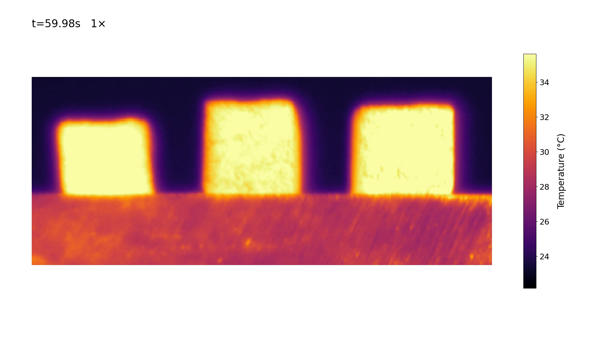
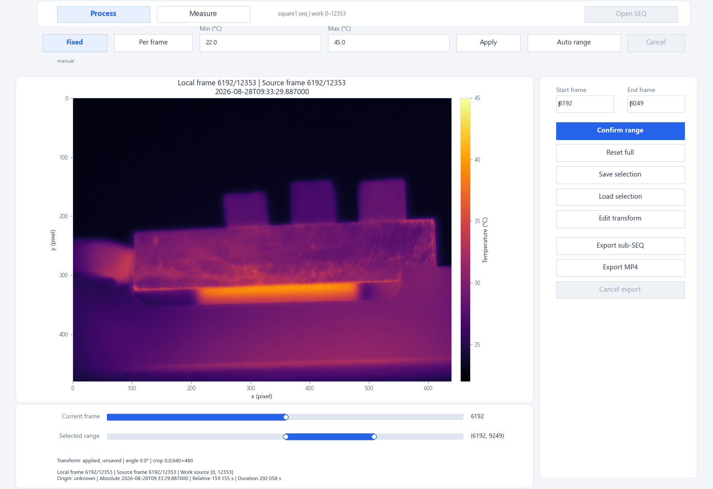
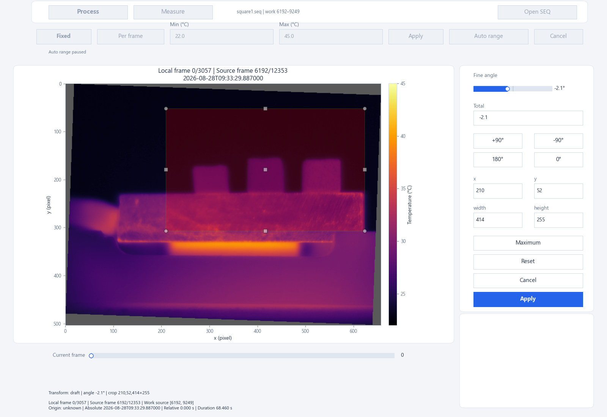
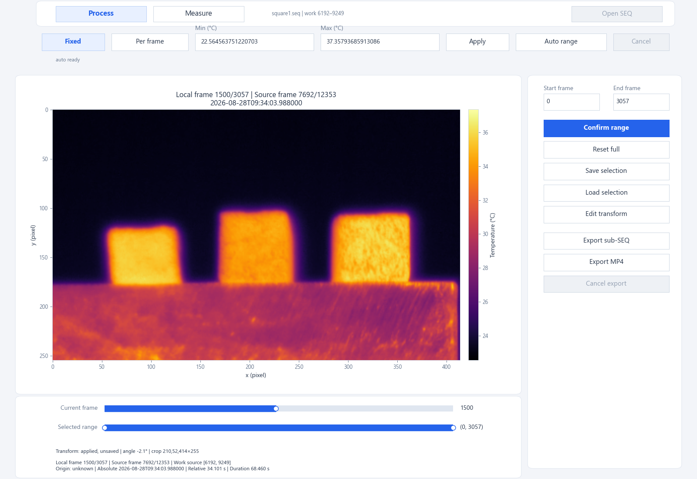
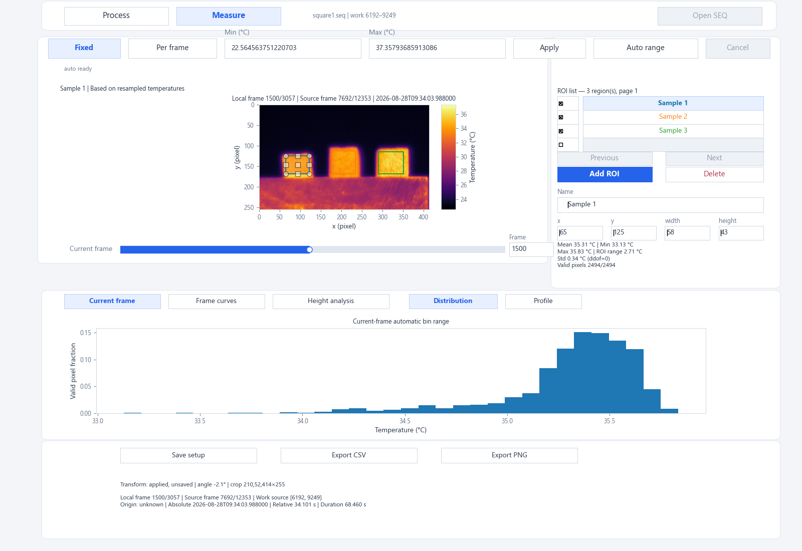
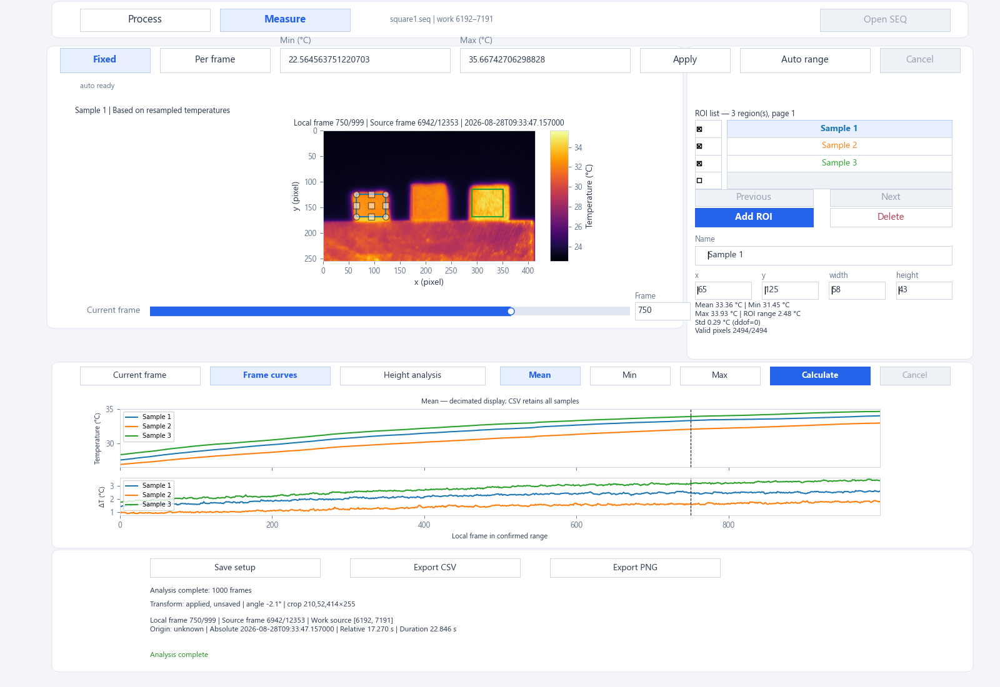
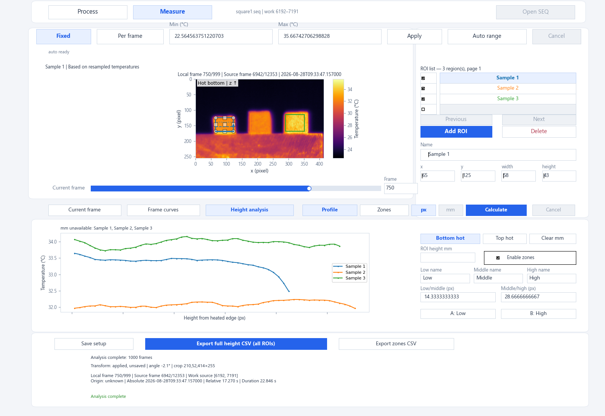
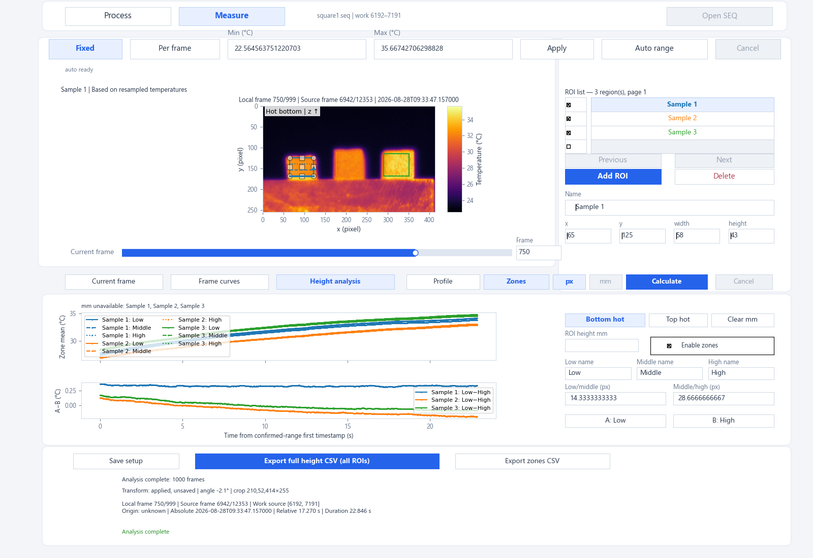

# FLIR SEQ Tool

**简体中文** | [English](README.en.md)

用于 FLIR ResearchIR FFF `.seq` 红外序列的本地检查、温度浏览、旋转裁剪与矩形区域分析。通过官方 FLIR Science File SDK 逐帧读取摄氏温度，提供 **Process（预处理）** 和 **Measure（测量）** 两个页面。

本工具不将整个 SEQ 载入内存，适合对较长序列选择时间范围、比较区域温度，并导出数据供后续分析。

[下载 Windows 便携版](https://github.com/hbn2333/flir-seq-tool/releases/tag/portable-preview-2026.11.14) · [快速开始](#快速开始) · [源码安装](#从源码安装) · [版本变更](CHANGELOG.md)

## 效果预览


*当前 Process 界面。左侧浏览温度场，右侧选择帧范围、编辑旋转裁剪并导出；顶部可切换固定或逐帧温标。本文操作截图由当前程序读取真实 SEQ 后直接导出界面画布，不含操作系统窗口边框。*

<details>
<summary>查看 MP4 导出示例</summary>

下面是使用本工具导出的三个样品红外展示视频：已应用旋转裁剪，保留固定温标，并显示相对时间和播放倍率。

[](docs/videos/square-0-6287.mp4)

[查看或下载完整 MP4](docs/videos/square-0-6287.mp4) · 1920×1080 · 30 fps · 1× · 约 2 分 16 秒 / 22 MB

左上角 `t` 根据 SEQ 源帧时间戳计算，以导出范围首帧为零；右侧色条单位为摄氏度。视频用于展示温度场变化，定量结果请使用 SEQ 和 CSV。

</details>

## 功能

- 检查图像尺寸、帧数、时间戳及时间连续性。
- 选择工作帧范围，使用全段自动固定、手动固定或逐帧自适应温标，旋转和裁剪显示/分析视图。
- 保存和加载处理方案及多个矩形 ROI。
- 查看当前帧均值、最小值、最大值、温差、标准差、温度分布和横纵剖面。
- 计算 ROI 随时间变化的温度与温差曲线。
- 沿 ROI 高度计算逐行均温 $T(z,t)$，支持独立毫米标定、上下受热方向，以及可选低／中／高分区。
- 在同一窗口使用 `Open SEQ` 切换文件。
- 导出 CSV、PNG、MP4 展示视频，以及带同名视图配置的原生子 SEQ。

暂不支持独立测温点、实验加热零点设置或外部传感器时间对齐。

本页对应 2026.11.14 便携预览版，已包含高度分析、同窗口切源、新温标模式与 Process 大图布局。

## 环境与安装

已验证环境为 **Windows x64、Python 3.13.5、FLIR Science File SDK 2026.1.2**

### Windows 文件夹便携版（预发布）

Windows 10/11 x64 使用者可以直接下载文件夹便携版，包内收集 Python、Tk、科学计算库、SDK 运行库和 FFmpeg，无需安装 Git、Python 或手动配置环境。

1. 在 Release 下载 `FLIR_SEQ_Tool-portable-preview-win64.zip`。
2. 完整解压到有写权限的位置，保留整个 `FLIR_SEQ_Tool` 文件夹。
3. 双击 `FLIR_SEQ_Tool.exe` 选择自己的 SEQ，也可将一个 SEQ 拖到 EXE 上。
4. 进入 Process 预处理，再到 Measure 分析；切换文件使用顶部 `Open SEQ`。

默认结果写入软件目录的 `output/clips`、`output/analysis`、`output/selections`；临时文件和日志位于 `cache`、`logs`。整个文件夹应放在有写权限的位置，不能只移动 EXE。原始数据不随包分发。

[下载 Windows x64 便携预览版（2026.11.14）](https://github.com/hbn2333/flir-seq-tool/releases/tag/portable-preview-2026.11.14)。此版本已通过本机自动诊断和用户本地试用，尚未在独立干净电脑上验收。旧版附件保留在 Release 历史中。

FLIR SDK 是专有第三方依赖，仓库公开不代表 SDK 获得开源授权。SDK 再分发条款的歧义、FFmpeg 对应源码及其他发行材料仍待核实，预发布同样受第三方许可约束。详情见 [便携版构建与验收](docs/PORTABLE.md)。

普通用户应下载 Release 附加的便携版 ZIP，并完整解压；GitHub 自动生成的 `Source code.zip` 是源码，仍需按下述流程配置开发环境。

### 从源码安装

#### 1. 准备官方 SDK

需要自行取得并安装 FLIR Science File SDK，以及与 Python 版本和架构匹配的官方 Python wheel（已验证为 CPython 3.13 / x64，即 cp313）。SDK、wheel 和实验 SEQ 不包含在仓库中；请按 FLIR 的许可与安装说明获取和使用。

#### 2. 克隆项目并创建环境

以下命令在 PowerShell 中执行，仓库可以克隆到自己的目录。

```powershell
git clone https://github.com/hbn2333/flir-seq-tool.git
cd flir-seq-tool

py -3.13 -m venv .venv
.\.venv\Scripts\python.exe -m pip install --upgrade pip setuptools
```

使用虚拟环境的 Python 安装官方 wheel。下面的路径是占位示例，请替换为实际文件：

```powershell
.\.venv\Scripts\python.exe -m pip install "C:\path\to\official-filesdk-cp313-wheel.whl"
.\.venv\Scripts\python.exe -m pip install -e .
```

NumPy、SciPy 和 Matplotlib 由项目依赖声明安装；官方 SDK 需单独安装。原生文件对话框还需要可用的 Tkinter。

导出 MP4 还需要 PATH 上可用的 FFmpeg，并包含 `libx264` 编码器。可用 `ffmpeg -version` 和 `ffmpeg -encoders` 检查；程序不会自动下载或安装 FFmpeg，也不需要 ffprobe。其余功能无需 FFmpeg。

#### 3. 检查环境

```powershell
.\.venv\Scripts\python.exe -c "import fnv.file, tkinter, flir_seq_tool; print('Imports OK')"
.\.venv\Scripts\python.exe -m flir_seq_tool --help
```

导入成功仅说明 Python 模块可用；还需用自己的 SEQ 验证 SDK 读取能力。

默认工作根目录按安装位置定位：源码检出中为项目根，便携版中为 EXE 旁的 `output`，不依赖当前终端目录。另存为可选择其他位置。工具保护当前源文件、文件别名、项目 `raw` 以及源文件所在路径的 `raw` 祖先目录；其他任意数据文件夹不会自动全部设为只读。请将输出与原始数据分开，并保留原始数据备份。

## 快速开始

便携版使用者直接打开 EXE，按下方流程操作即可。源码使用者也可以从命令行启动；以下路径是示例，请替换成自己的文件，并使用已安装 SDK 的同一个 Python 环境。

```powershell
# 快速检查元信息
.\.venv\Scripts\python.exe -m flir_seq_tool inspect "C:\data\experiment.seq"

# 打开查看器
.\.venv\Scripts\python.exe -m flir_seq_tool view "C:\data\experiment.seq"

# 可选：直接指定手动固定温标（摄氏度）
.\.venv\Scripts\python.exe -m flir_seq_tool view "C:\data\experiment.seq" --vmin 20 --vmax 45
```

如果已激活该环境，也可以使用 `python -m flir_seq_tool`，或安装后的 `flir-seq` 命令。

推荐流程：

1. **Process**：选时间范围 → Confirm range → 旋转裁剪 → Apply。
2. **Measure**：添加 ROI → 检查当前帧 → 切到 Frame curves → Calculate 生成帧曲线；沿高度比较使用 [Height analysis](#高度剖面与分区)。
3. **保存配置**：Save setup 保存工作范围、变换和 ROI。
4. **导出结果**：Export CSV / Export PNG；如需另存时间切片，回 Process 使用 Export sub-SEQ。

建议窗口至少为 1000×800（100 DPI）。长名称、路径和错误信息可按 **F1** 查看完整详情。

顶部 `Open SEQ` 可以在原窗口打开其他文件。有未保存设置时可保存后打开、放弃或取消；这里的保存统一使用 Process 候选范围，并保存变换及全部 ROI 设置，不保存计算结果。打开失败会保留原会话。后台任务、变换草稿或正在画 ROI 时需先结束当前操作。

## Process：范围与图像修整

Process 采用左侧大云图、右侧操作面板；帧与候选范围滑块位于图下方。旋转裁剪时右侧切换为编辑控件，Measure 保留独立的测量布局。

### 时间范围

- `Current frame` 浏览当前工作范围。
- `Selected range` 选择候选区间；也可在右侧 `Start frame` / `End frame` 输入整数帧号并按 Enter。
- `Confirm range` 将候选区间设为工作范围，局部帧从 0 重新编号。可重复缩小范围。
- `Reset full` 恢复完整时间范围，不等于重置旋转裁剪。

标题和状态区同时显示局部帧、源帧、绝对时间、相对时间和持续时间。相对时间以当前工作范围首帧为零，**不是实验加热起点**。上述操作不会改写原始 SEQ。



*图 1｜时间范围选择（帧裁剪）。使用 Selected range 或 Start frame / End frame 指定候选区间，再点击 Confirm range 确认。截图展示的是尚未确认的候选范围；若要生成独立子 SEQ，需另行导出。*

### 温标模式

顶部温标控件在 Process 和 Measure 共用。温标只控制颜色映射，不改变温度矩阵，也不使已有 ROI 或高度计算结果失效。

| 方式 | 操作与范围 | 适合用途 |
| --- | --- | --- |
| 自动固定 | 选择 `Fixed`，点击 `Auto range`；扫描已确认范围的全部帧，以有限温度的最小值和最大值作为统一范围 | 跨帧比较同一种颜色所代表的温度 |
| 手动固定 | 在 `Fixed` 下编辑 `Min (°C)` / `Max (°C)`，点击 `Apply` | 多组实验采用相同温标，或突出指定温度区间 |
| 逐帧自适应 | 选择 `Per frame`，按当前帧的有限温度范围更新图像和色条 | 查看各帧内部的温度分布；不同帧的同色不一定同温 |

没有配套配置和显式温标的新会话默认自动固定。统计使用**已应用旋转裁剪后的整幅图像**，排除 NaN、Inf 和无效背景；不按百分位裁掉极值，也不受 ROI 位置和勾选影响。初始扫描覆盖完整文件，Confirm range、Reset full 或应用新变换后改为对应范围；仅拖动候选范围或浏览帧不会重复扫描。

扫描逐帧进行并显示进度，期间仍可浏览和切换页面。完成前使用当前帧的临时范围，状态显示 `temporary`，不能将它当作已经完成的全段固定结果。扫描期间暂缓 Calculate、原生 SEQ、MP4 和全量 CSV 等重任务；当前帧 PNG 仍可导出，并标明临时温标。温标旁的 `Cancel` 取消扫描，之后点击 `Auto range` 重试；取消需等待当前帧读取结束。

Min/Max 输入中的文字是草稿，**Enter 或失焦不会应用，需点击温标旁的 Apply**。扫描完成或切帧不会覆盖草稿。切换 Per frame 会保留固定范围及草稿，回 Fixed 后恢复；Auto range 会放弃草稿并恢复自动策略。保存配置只保存已应用设置，切换文件前会提示处理未应用输入。

自动范围遇到常值时向两侧各扩展 0.5 °C。全无效帧会显示提示；逐帧或临时显示沿用最近有效显示范围，尚无有效范围时使用 0～1 占位，已生效的固定范围则保持不变。全段没有有效温度时扫描失败，不保存部分结果。

### 旋转与裁剪

1. 点击 `Edit transform`。
2. 用 ±90° / 180° 快捷按钮调整方向，再用 `Fine angle` 在当前直角方向的 ±15° 内微调，精度 0.1°；`Total` 输入总角度。
3. 拖动裁剪框或手柄，也可输入整数 `x / y / width / height`。这些坐标属于旋转后的画布。
4. `Apply` 应用，`Cancel` 放弃草稿；之后可以重新编辑。



*图 2｜旋转裁剪编辑。左侧预览旋转结果和裁剪框，右侧调整角度及 x、y、width、height；此时仍是草稿，需 Apply 才生效。*



*图 3｜应用后的视图。点击 Apply 后，图像按选定角度和裁剪范围显示，像素坐标从裁剪后图像的左上角重新起算。Apply 不等于保存配置，也不会改写原始 SEQ。*

改变角度会重置裁剪框。`Maximum` 选择最大有效矩形，旋转空白区不可纳入有效裁剪。`Reset` 恢复未旋转、未裁剪的草稿，需 Apply 才生效。

同一变换用于整个序列，顺序为先旋转、后裁剪。直角旋转和纯裁剪使用像素重排，其他角度使用双线性插值。**非直角旋转后的测量值基于重采样温度，不等同于原始探测像素值。**

已有 ROI 时应用不同变换会要求确认清空 ROI，建议先完成修整再测量。

## Measure：矩形区域分析

Measure 使用 **已 Confirm range 的范围**和**已 Apply 的变换**，不使用未确认范围或编辑中的变换草稿。

### 添加和编辑 ROI

点击 `Add ROI`，在图像中拖框；Esc 取消。右侧可改名、输入整数坐标与尺寸或删除 ROI，列表支持分页。

- 点击列表行：选择当前编辑和分析的 ROI。
- 勾选列表框：控制图形中显示哪些 ROI，以及原整块帧曲线 CSV 的导出项；新增的完整高度 CSV 始终导出全部 ROI。
- ROI 坐标使用裁剪后的图像坐标系，左上角为原点，x 向右、y 向下，单位为像素。



*图 4｜矩形 ROI 与当前帧分析。各框对应样品内部区域，右侧显示当前选中 ROI 的参数和温度统计，下方 Distribution 显示其有效像素温度分布。ROI 极差为区域内 max−min。*

### 当前帧

统计卡片给出均值、最小值、最大值、温差、总体标准差（ddof=0）及有效/总像素数，仅统计有限温度值。

- `Distribution`：32 个自动温度箱，显示有效像素比例；不同帧的箱边界可能不同。
- `Profile → Horizontal / Vertical`：分别按列或按行求均值，横轴是像素坐标，不是毫米。
- ΔT 表示**同一帧、同一个 ROI 内的最大温度减最小温度**，不是温升或不同样品之间的温差。

### 帧曲线

进入 `Frame curves`，点击 `Calculate`。上图选择 Mean / Min / Max，下图显示 ΔT。

计算扫描工作范围内所有 ROI，包括未勾选项。计算期间暂停编辑和其他导出，可用 Cancel 请求取消；需等待当前 SDK 调用结束。

改变范围或 ROI 几何后必须重新计算。改名、勾选和切换显示指标不需重算。曲线显示可能抽稀以改善性能，但 CSV 保留全部统计行。计算使用临时 SQLite 存储，不保存全序列温度矩阵到内存。



*图 5｜多个 ROI 与帧曲线。勾选需要比较的区域，在 Frame curves 中点击 Calculate。示例上图显示各 ROI 的平均温度，下图显示各 ROI 内的最大最小温差 ΔT；曲线颜色与区域颜色对应，横轴为已确认范围内的局部帧号。图 5～7 使用源帧 6192～7191 作为较短的演示范围。*

### 高度剖面与分区

在每个样品内部画纵向矩形 ROI，切到 `Height analysis`：

1. 选中 ROI，用 `Bottom hot` / `Top hot` 指定受热端；高度正方向从热端指向另一端。
2. 默认使用 px。需要毫米时，在 `ROI height mm` 输入当前矩形覆盖的实际高度，按 Enter；不同 ROI 分别标定。`Clear mm` 清除此 ROI 的标定。
3. `Profile` 显示当前帧的温度–高度曲线，随帧滑块更新。只有所有勾选 ROI 都已标定时，才可切到 mm 叠加比较。
4. 点击 `Calculate` 计算已确认范围内全部 ROI 的完整高度数据。随后使用 `Export full height CSV (all ROIs)`，通过另存为选择输出位置。

每行只对有限温度像素取横向平均，不做温度阈值过滤或平滑。零点在 ROI 的受热端外边界，行中心位置为 0.5、1.5…$H-0.5$ px；输入实际高度 $L$ 后，毫米比例为 $L/H$。移动或调整 ROI 宽度保留比例；改变高度也保留比例并更新所覆盖长度，但几何改变后需重算。



*图 6｜沿 ROI 高度的当前帧温度剖面。高度从所选受热端指向另一端，每个点为对应像素行内有效温度的横向平均。示例使用像素单位，没有假设样品的实际毫米尺寸；曲线随当前帧更新。*

每个 ROI 的 `Enable zones` 默认关闭。勾选后可设置低／中／高的名称、两个分界位置和温差区间 A/B；低区始终靠近热端。分界跟随 px/mm 单位显示，内部保存为高度比例。每区至少要有一行，非法输入不会替换最后有效设置；ROI 变短导致空区时会关闭分区并提示。

`Zones` 上图比较各 ROI 的三段均温，下图显示有符号的 **区间均温差 A−B**。区间均温对全部有效像素加权，不对各行均温等权平均。**ROI 极差（max−min）**仍保留原含义，两者不能混用。

A/B 用于选择做差的两个高度区间。例如 A 选 Low、B 选 High，就是靠近热端区间的均温减去远端区间的均温；交换 A/B 会改变差值符号。



*图 7｜高度分区曲线。示例将各 ROI 分为三段，Low 靠近受热端，High 远离受热端。上图比较分区均温，下图显示所选区间的均温差 A−B；横轴为所有 ROI 共用的相对时间，单位为秒。*

高度时间曲线统一使用已确认范围首帧的实际时间戳为零，横轴为秒；各样品不会分别归零。重复或倒退时间保留并标记，图形断开对应连接。图形可以抽稀，CSV 保留全量。高度方向、标定、分区和 A/B 改动可复用已算行数据；范围、ROI 几何或图像变换改变后需重算。

## 保存、加载与导出

| 操作                    | 保存内容                                    | 注意事项                                               |
| ----------------------- | ------------------------------------------- | ------------------------------------------------------ |
| Process：Save selection | 候选帧范围、已应用变换、温标和 ROI 设置     | 候选范围可能不同于测量范围                             |
| Measure：Save setup     | 已确认工作范围、已应用变换、温标和 ROI 设置 | 不包含已计算的帧曲线                                   |
| Process：Load selection | 打开用户选定的配置                          | 不是自动选择最新文件；加载后曲线需重新计算             |
| Export CSV / PNG        | 当前分析子视图对应的数据或图像              | 先切到需要导出的 Distribution、Profile 或 Frame curves |
| Export full height CSV | 全部 ROI、全部已确认帧、全部高度行           | 不受 ROI 勾选和 Enable zones 影响；先完成高度 Calculate |
| Export zones CSV       | 全部已启用分区 ROI 的三段均温与 A−B         | 不受图形勾选影响；无启用分区时不可导出                  |
| Export sub-SEQ          | 所选时间段的原始帧及同名视图配置            | 不把旋转裁剪结果写入 SEQ 像素                          |
| Export MP4              | 已确认范围的热图、色条、相对时间及倍率      | 使用已应用变换；仅用于展示                             |

### 配置文件

`Apply` 仅应用变换，**不保存文件**。用 Save selection 或 Save setup 另存为 `.selection.json`。

配置包含源文件身份，加载时严格核验；源文件改名、内容或修改时间改变可能导致核验失败。配置支持多个命名方案，覆盖需确认，并保留单份 `.bak`。当前 schema 为 v5，兼容读取 v1～v4；保存温标模式、固定策略与数值、已完成自动范围的输入标识，以及各 ROI 的受热端、标定、分区和已记录来源链，不保存临时计算表。加载后需重新 Calculate。

旧版 v1～v4 配置按手动固定温标恢复，原数值继续生效；需要新的全段自动规则时点击 Auto range。自动范围仅在源文件身份、已确认帧范围和已应用变换都匹配时复用。Process 保存了不同的候选范围时，重载后会重新扫描对应范围。

### CSV 与 PNG

在需要的分析子视图点击 `Export CSV` 或 `Export PNG`，选择路径：

- 帧曲线 CSV 为长表：每帧、每个勾选 ROI 一行，包含温度统计。
- Distribution CSV 为当前活跃 ROI 的温度分箱数据。
- Profile CSV 为当前活跃 ROI、当前方向的像素剖面数据。
- CSV 使用 UTF-8 BOM，包含源身份、变换、ROI、帧号、时间及版本等追溯字段。
- PNG 单独绘制分析图，不包含软件按钮等界面元素；使用触发导出时的实际温标，标明模式、临时范围或无有效温度状态，并在 PNG 元数据中保存温标策略和实际上下限。导出期间的切帧或扫描完成不会改写这份快照。

帧曲线尚未计算、已失效或没有勾选 ROI 时不能导出曲线。

高度模式有独立的两个 CSV 入口：

- **完整高度长表**：每 ROI × 每帧 × 每高度行一条，按局部帧、ROI 创建顺序、高度递增排序；包括未勾选 ROI、未启用分区 ROI，以及没有有效温度的行。温度缺失留空，有效像素数为 0。
- **分区宽表**：每个已启用分区 ROI × 每帧一条，含三段名称、边界、均温、有效数，以及 `zone_delta_c`（A−B）与 `roi_range_c`（整 ROI 的 max−min）。

两表均包含源身份、旋转裁剪参数、ROI 坐标、热端与方向、标定、源帧号、局部帧号、原时间戳、共同相对时间和时间状态。未标定时毫米字段为空。只有记录了父文件映射时才填写 `origin_frame`，指向最早已记录祖先；它不代表已证实的最初录像。旧文件没有来源记录时标为 `unknown`。

高度 CSV 在后台逐批读写，显示进度并可取消；验证通过后才替换目标，失败或取消保留旧文件。长序列和高 ROI 会产生较大的 CSV，请为输出预留空间。高度模式目前提供数据导出，原 `Current frame` / `Frame curves` 的独立 PNG 导出继续保留。

### 原生子 SEQ

点击 `Export sub-SEQ` → 选择目录与文件名 → 核对摘要 → 点击蓝色 `Confirm export`。蓝色表示等待最终确认，尚未开始提取；取消或更改输入后恢复默认状态。文件名未填扩展名时补充 `.seq`。取消另存为不会启动导出。

例如选择 `trial_A.seq`，会在同一目录生成：

```text
trial_A.seq
trial_A.selection.json
```

**SEQ 保留原方向、完整像素尺寸和原始温度帧；旋转裁剪保存在配套 JSON 中。** 本工具重新打开子 SEQ 时自动核验并加载同目录同名配置；其他软件只打开 SEQ 时仍看到原始像素。请一起移动两个文件，保留名称和 SEQ 修改时间。

配套配置保留温标模式和手动固定值。自动固定不会把父文件的扫描标识套到子文件上，重开后按子文件自身的工作范围重新计算；逐帧模式继续逐帧更新。

覆盖状态显示在摘要首行；预览后目标被外部修改会要求再次确认。提取阶段可取消，两文件最终发布期间不可取消。

若出现 `.export-pending.json`，说明存在未完成的发布或恢复过程。保留标记及恢复材料，查看错误详情并核查文件，不要直接删除标记。成对文件发布不等于跨文件原子事务，也不保证断电自动恢复。

### MP4 展示视频

在 Process 页点击 `Export MP4` → 选择 1×、2×、5× 或 10× → 另存为 → 核对摘要并确认。

视频使用已 Confirm range 的范围、已 Apply 的旋转裁剪、当前配色和温标模式。输出为 1920×1080、30 fps、H.264，无音轨；图像保持宽高比，右侧显示摄氏温度色条，上方显示 `t=12.34s`、倍率和温标模式，不包含软件按钮、ROI 或曲线。相对时间以导出范围首帧为零。

固定模式的所有画面使用同一范围。自动固定需等待当前完整范围的扫描完成，即使视频会跳帧，也使用全部已确认源帧的温度极值；临时结果不能用于固定视频导出。逐帧模式按每个实际渲染源帧更新图像和色条，视频显示 `Per-frame adaptive`。无有效温度时显示提示，逐帧模式使用最近有效范围，初始没有有效范围时为 0～1。

时间文字来自 SEQ 每帧实际时间戳：`t = 当前画面对应源帧时间 − 导出范围首帧时间`，显示到 0.01 秒。例如 5× 视频播放 1 秒，对应约 5 秒的源序列过程；显示精度不代表相机测时精度，也不代表实验加热起点。

帧选择按源时间戳映射到视频时间网格，可能重复或跳过源帧，保证播放速度与实验时间对应；不在时间方向插值温度。最后一帧保留，视频时长比源持续时间除以倍率多不到两个输出帧周期。单帧范围导出 1 秒静止视频。重复或倒退的时间戳会阻止导出。

时间预检、编码和完整解码验证期间可使用 `Cancel export`；窗口关闭也会回收任务。发布前会再次检查源文件和目标快照；确认后目标被外部修改会报错。覆盖仅在验证成功后进行，取消或失败保留原有 MP4。视频不包含逐像素温度数据，也不生成 selection 配套文件；定量分析请保存 SEQ、配置或 CSV。

## 命令行参考

```powershell
# JSON 元信息
python -m flir_seq_tool inspect "C:\data\experiment.seq" --json

# 扫描所有时间戳（大文件耗时更长）
python -m flir_seq_tool inspect "C:\data\experiment.seq" --timestamp-mode full --json

# 从源帧 20 打开
python -m flir_seq_tool view "C:\data\experiment.seq" --frame 20
```

默认 endpoints 模式只检查首末时间，不检查连续性、不估算帧率。full 模式检查重复、倒退及超过正时间间隔中位数 3 倍的间隔；异常索引 i 表示帧 i 与 i+1 之间。

`--vmin` 和 `--vmax` 必须同时指定、有限且递增，按手动固定温标生效，并优先于配置。无配套配置和显式温标时，默认扫描已确认范围全部帧，使用有限温度的完整最小值和最大值。

`--frame` 指当前 SEQ 的源帧号。省略时从恢复范围首帧开始；指定帧在文件内但不在恢复范围内时，提示后显示范围首帧。

## 常见问题

**No module named flir_seq_tool**

用启动程序的同一个 Python 执行 `python -m pip install -e .`。检查是否误用了另一个虚拟环境或 Anaconda 环境。

**No module named fnv / SDK DLL 加载失败**

确认官方 SDK 已安装，官方 wheel 与 Python 版本和 x64 架构匹配，并安装在当前环境中。SDK 运行库的配置以官方说明为准；仅安装本仓库不会安装 SDK。

**重开后 ROI 或曲线没有恢复**

先用 Save setup 保存 ROI，再用 Load selection 明确打开该配置。只有同目录同名配置会随 SEQ 自动加载；帧曲线不存入配置，需要重新 Calculate。

**导出的 SEQ 没有裁剪**

这是原生导出语义。旋转裁剪由同名配置恢复；用于报告的分析图请导出 PNG，数值请导出 CSV。

**矩形最低温或 ΔT 异常**

检查 ROI 是否包含背景、样品边缘或无效区域，并核对所用变换。它们是区域像素统计，不能单凭温度高低判断材料导热系数。

## 开发与测试

```powershell
python -m pip install pytest
python -m pytest tests/unit -q -rs -p no:cacheprovider
```

单元测试仍需要可导入的官方 SDK。旧集成测试依赖仓库未提供的特定真实 SEQ 及其固定基线，缺少指定样本时明确跳过；高度及温标端到端测试使用本地 `raw` 中最小的 SEQ，温标另有 Q1.seq 全范围参考遍历核对。没有测试数据时，不要把完整测试命令当作新安装的必要步骤。

维护者具备测试数据时可运行：

```powershell
python -m pytest -q -rs -p no:cacheprovider
```

pytest 配置禁用 napari 插件自动加载，以避免已观察到的 Windows DLL 冲突。部分符号链接测试可能因 Windows 权限不足跳过。对话框替身和离屏渲染测试不能代替原生窗口人工试用。

参见 [变更记录](CHANGELOG.md)、[已知问题及验收记录](docs/KNOWN_ISSUES.md) 和 [维护流程](docs/MAINTENANCE.md)。这些维护文档可能包含开发者本地实验路径，不是用户安装要求。
