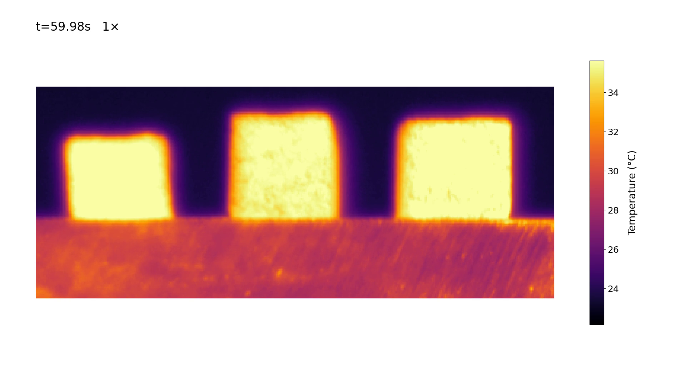
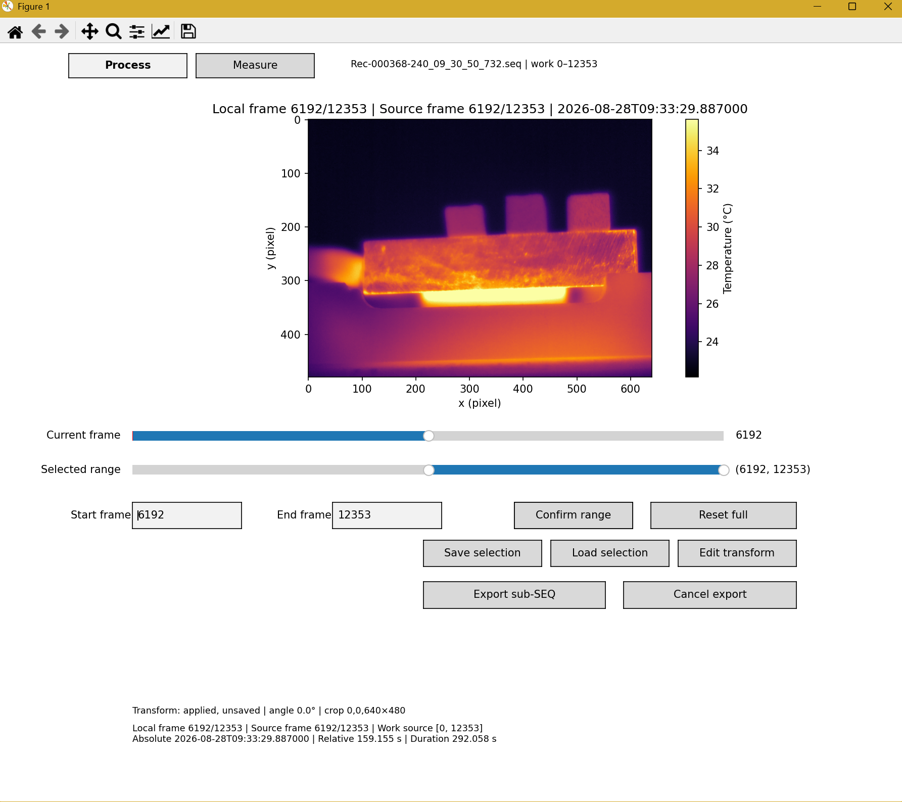
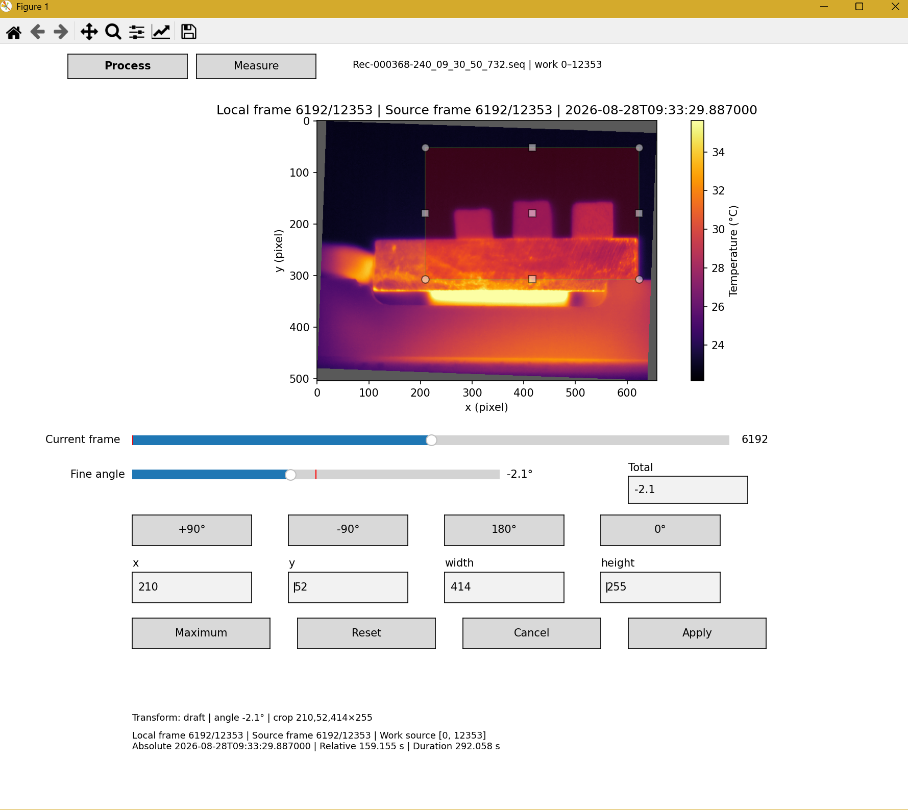
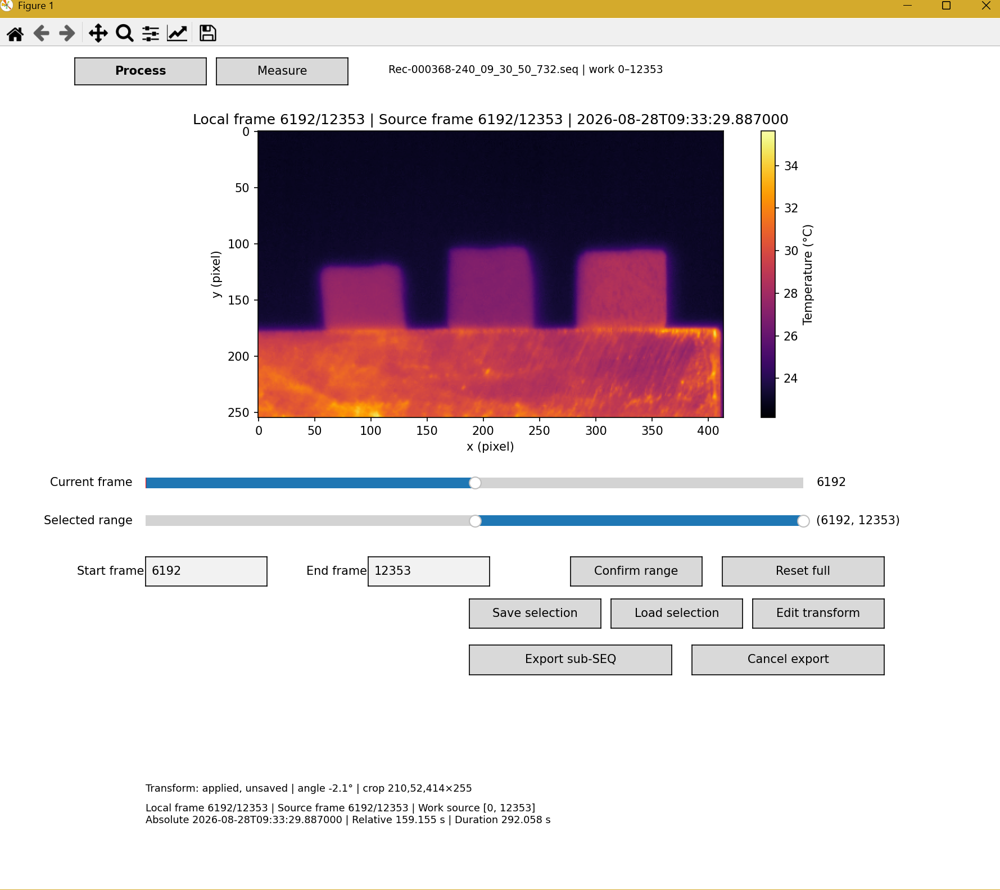
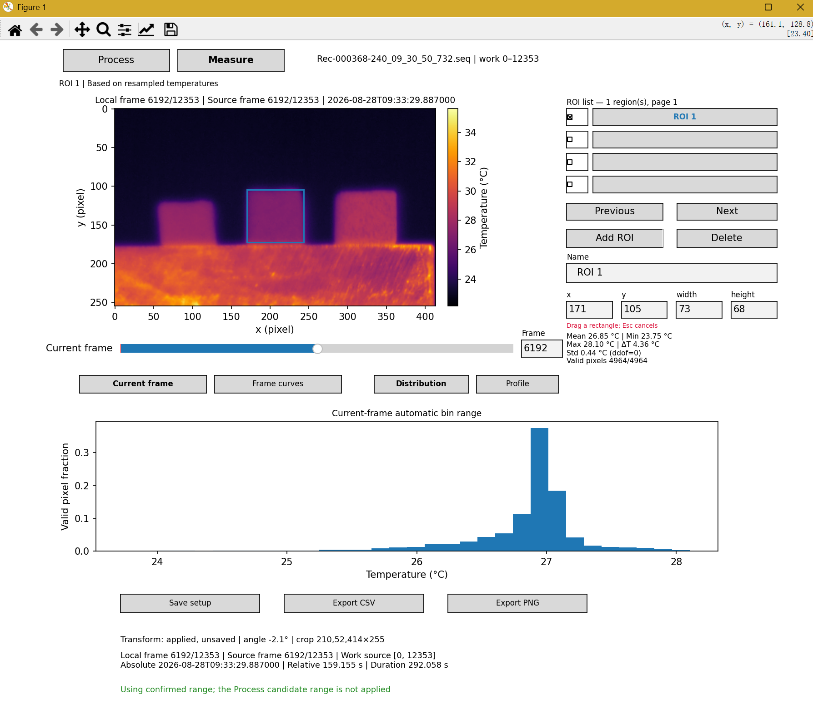
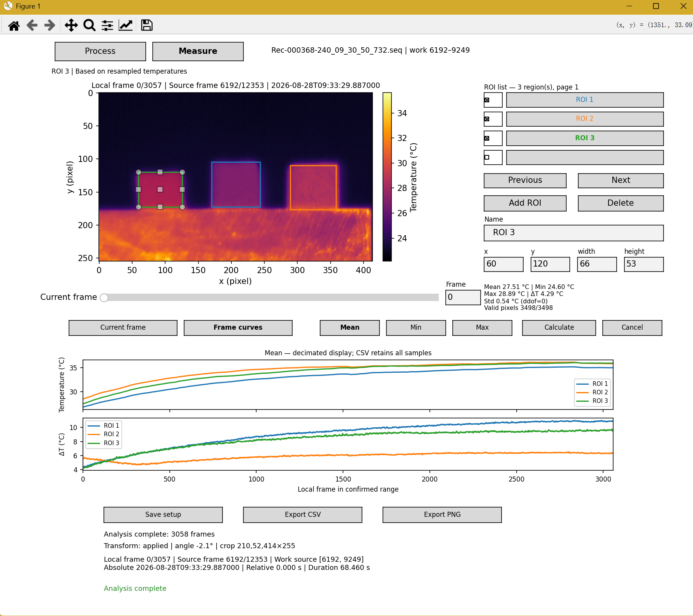

# FLIR SEQ Tool

用于 FLIR ResearchIR FFF `.seq` 红外序列的本地检查、温度浏览、旋转裁剪与矩形区域分析。通过官方 FLIR Science File SDK 逐帧读取摄氏温度，提供 **Process（预处理）** 和 **Measure（测量）** 两个页面。

本工具不将整个 SEQ 载入内存，适合对较长序列选择时间范围、比较区域温度，并导出数据供后续分析。

## 效果预览

下面是使用本工具导出的三个样品红外展示视频：已应用旋转裁剪，保留固定温标，并显示相对时间和播放倍率。

[](docs/videos/square-0-6287.mp4)

[查看或下载完整 MP4](docs/videos/square-0-6287.mp4) · 1920×1080 · 30 fps · 1× · 约 2 分 16 秒 / 22 MB

左上角 `t` 根据 SEQ 源帧时间戳计算，以导出范围首帧为零；右侧色条单位为摄氏度。视频用于展示温度场变化，定量结果请使用 SEQ 和 CSV。

## 功能

- 检查图像尺寸、帧数、时间戳及时间连续性。
- 选择工作帧范围、固定温标、旋转和裁剪显示/分析视图。
- 保存和加载处理方案及多个矩形 ROI。
- 查看当前帧均值、最小值、最大值、温差、标准差、温度分布和横纵剖面。
- 计算 ROI 随时间变化的温度与温差曲线。
- 导出 CSV、PNG、MP4 展示视频，以及带同名视图配置的原生子 SEQ。

暂不支持独立测温点、实验加热零点设置或外部传感器时间对齐。

## 环境与安装

已验证环境为 **Windows x64、Python 3.13.5、FLIR Science File SDK 2026.1.2**

### Windows 文件夹便携版（预发布）

正在验证 Windows 10/11 x64 的文件夹版：完整解压后双击 `FLIR_SEQ_Tool.exe` 选择 SEQ，也可将一个 SEQ 拖到 EXE 上。包内收集 Python、Tk、科学计算库、SDK 运行库和 FFmpeg，使用者无需安装 Git、Python 或手动配置环境。

默认结果写入软件目录的 `output/clips`、`output/analysis`、`output/selections`；临时文件和日志位于 `cache`、`logs`。整个文件夹应放在有写权限的位置，不能只移动 EXE。原始数据不随包分发。

[下载 Windows x64 便携预览版](https://github.com/hbn2333/flir-seq-tool/releases/tag/portable-preview-2026.10.28)。此版本已做本机迁移测试，尚未在独立干净电脑上验收；双击选文件、取消与拖入文件仍需人工验证。

FLIR SDK 是专有第三方依赖，仓库公开不代表 SDK 获得开源授权。SDK 再分发条款的歧义、FFmpeg 对应源码及其他发行材料仍待核实，预发布同样受第三方许可约束。详情见 [便携版构建与验收](docs/PORTABLE.md)。

普通用户应下载 Release 附加的便携版 ZIP，并完整解压；GitHub 自动生成的 `Source code.zip` 是源码，仍需按下述流程配置开发环境。

### 从源码安装

### 1. 准备官方 SDK

需要自行取得并安装 FLIR Science File SDK，以及与 Python 版本和架构匹配的官方 Python wheel（已验证为 CPython 3.13 / x64，即 cp313）。SDK、wheel 和实验 SEQ 不包含在仓库中；请按 FLIR 的许可与安装说明获取和使用。

### 2. 克隆项目并创建环境

以下命令在 PowerShell 中执行，仓库可以克隆到自己的目录。

```powershell
git clone https://github.com/hbn2333/flir-seq-tool.git
cd flir-seq-tool

py -3.13 -m venv .venv
.\.venv\Scripts\python.exe -m pip install --upgrade pip setuptools
```

使用虚拟环境的 Python 安装官方 wheel。下面的路径是占位示例，请替换为实际文件：

```powershell
.\.venv\Scripts\python.exe -m pip install "C:\path\to\official-filesdk-cp313-wheel.whl"
.\.venv\Scripts\python.exe -m pip install -e .
```

NumPy、SciPy 和 Matplotlib 由项目依赖声明安装；官方 SDK 需单独安装。原生文件对话框还需要可用的 Tkinter。

导出 MP4 还需要 PATH 上可用的 FFmpeg，并包含 `libx264` 编码器。可用 `ffmpeg -version` 和 `ffmpeg -encoders` 检查；程序不会自动下载或安装 FFmpeg，也不需要 ffprobe。其余功能无需 FFmpeg。

### 3. 检查环境

```powershell
.\.venv\Scripts\python.exe -c "import fnv.file, tkinter, flir_seq_tool; print('Imports OK')"
.\.venv\Scripts\python.exe -m flir_seq_tool --help
```

导入成功仅说明 Python 模块可用；还需用自己的 SEQ 验证 SDK 读取能力。

默认工作根目录按安装位置定位：源码检出中为项目根，便携版中为 EXE 旁的 `output`，不依赖当前终端目录。另存为可选择其他位置。工具保护当前源文件、文件别名、项目 `raw` 以及源文件所在路径的 `raw` 祖先目录；其他任意数据文件夹不会自动全部设为只读。请将输出与原始数据分开，并保留原始数据备份。

## 快速开始

以下 `C:\data\experiment.seq` 是示例，请替换成自己的文件路径。后续命令均在仓库目录执行，使用同一个已安装 SDK 的 Python 环境。

```powershell
# 快速检查元信息
.\.venv\Scripts\python.exe -m flir_seq_tool inspect "C:\data\experiment.seq"

# 打开查看器
.\.venv\Scripts\python.exe -m flir_seq_tool view "C:\data\experiment.seq"

# 可选：固定温标（摄氏度）
.\.venv\Scripts\python.exe -m flir_seq_tool view "C:\data\experiment.seq" --vmin 20 --vmax 45
```

如果已激活该环境，也可以使用 `python -m flir_seq_tool`，或安装后的 `flir-seq` 命令。

推荐流程：

1. **Process**：选时间范围 → Confirm range → 旋转裁剪 → Apply。
2. **Measure**：添加 ROI → 检查当前帧 → Calculate 生成帧曲线。
3. **保存配置**：Save setup 保存工作范围、变换和 ROI。
4. **导出结果**：Export CSV / Export PNG；如需另存时间切片，回 Process 使用 Export sub-SEQ。

建议窗口至少为 1000×800（100 DPI）。长名称、路径和错误信息可按 **F1** 查看完整详情。

## Process：范围与图像修整

### 时间范围

- `Current frame` 浏览当前工作范围。
- `Selected range` 选择候选区间；也可在 `Start frame` / `End frame` 输入整数帧号并按 Enter。
- `Confirm range` 将候选区间设为工作范围，局部帧从 0 重新编号。可重复缩小范围。
- `Reset full` 恢复完整时间范围，不等于重置旋转裁剪。

标题和状态区同时显示局部帧、源帧、绝对时间、相对时间和持续时间。相对时间以当前工作范围首帧为零，**不是实验加热起点**。上述操作不会改写原始 SEQ。



*图 1｜时间范围选择（帧裁剪）。使用 Selected range 或 Start frame / End frame 指定候选区间，再点击 Confirm range 确认。截图展示的是尚未确认的候选范围；若要生成独立子 SEQ，需另行导出。*

### 旋转与裁剪

1. 点击 `Edit transform`。
2. 用 ±90° / 180° 快捷按钮调整方向，再用 `Fine angle` 在当前直角方向的 ±15° 内微调，精度 0.1°；`Total` 输入总角度。
3. 拖动裁剪框或手柄，也可输入整数 `x / y / width / height`。这些坐标属于旋转后的画布。
4. `Apply` 应用，`Cancel` 放弃草稿；之后可以重新编辑。



*图 2｜旋转裁剪编辑。示例将总角度调整为 −2.1°，并用裁剪框选择保留区域；也可通过 x、y、width、height 输入框精确调整。此时仍是草稿。*



*图 3｜应用后的视图。点击 Apply 后，图像按选定角度和裁剪范围显示，像素坐标从裁剪后图像的左上角重新起算。Apply 不等于保存配置，也不会改写原始 SEQ。*

改变角度会重置裁剪框。`Maximum` 选择最大有效矩形，旋转空白区不可纳入有效裁剪。`Reset` 恢复未旋转、未裁剪的草稿，需 Apply 才生效。

同一变换用于整个序列，顺序为先旋转、后裁剪。直角旋转和纯裁剪使用像素重排，其他角度使用双线性插值。**非直角旋转后的测量值基于重采样温度，不等同于原始探测像素值。**

已有 ROI 时应用不同变换会要求确认清空 ROI，建议先完成修整再测量。

## Measure：矩形区域分析

Measure 使用 **已 Confirm range 的范围**和**已 Apply 的变换**，不使用未确认范围或编辑中的变换草稿。

### 添加和编辑 ROI

点击 `Add ROI`，在图像中拖框；Esc 取消。右侧可改名、输入整数坐标与尺寸或删除 ROI，列表支持分页。

- 点击列表行：选择当前编辑和分析的 ROI。
- 勾选列表框：控制帧曲线及曲线导出包含哪些 ROI。
- ROI 坐标使用裁剪后的图像坐标系，左上角为原点，x 向右、y 向下，单位为像素。



*图 4｜添加矩形 ROI。点击 Add ROI 后在图像中拖框，右侧显示区域参数和当前帧统计，下方 Distribution 显示温度分布。截图底部提示候选时间范围尚未应用；测量仍使用已确认的工作范围。*

### 当前帧

统计卡片给出均值、最小值、最大值、温差、总体标准差（ddof=0）及有效/总像素数，仅统计有限温度值。

- `Distribution`：32 个自动温度箱，显示有效像素比例；不同帧的箱边界可能不同。
- `Profile → Horizontal / Vertical`：分别按列或按行求均值，横轴是像素坐标，不是毫米。
- ΔT 表示**同一帧、同一个 ROI 内的最大温度减最小温度**，不是温升或不同样品之间的温差。

### 帧曲线

进入 `Frame curves`，点击 `Calculate`。上图选择 Mean / Min / Max，下图显示 ΔT。

计算扫描工作范围内所有 ROI，包括未勾选项。计算期间暂停编辑和其他导出，可用 Cancel 请求取消；需等待当前 SDK 调用结束。

改变范围或 ROI 几何后必须重新计算。改名、勾选和切换显示指标不需重算。曲线显示可能抽稀以改善性能，但 CSV 保留全部统计行。计算使用临时 SQLite 存储，不保存全序列温度矩阵到内存。



*图 5｜多个 ROI 与帧曲线。勾选需要比较的区域，在 Frame curves 中点击 Calculate。示例上图显示各 ROI 的平均温度，下图显示各 ROI 内的最大最小温差 ΔT；曲线颜色与区域颜色对应，横轴为已确认范围内的局部帧号。*

## 保存、加载与导出

| 操作                    | 保存内容                                    | 注意事项                                               |
| ----------------------- | ------------------------------------------- | ------------------------------------------------------ |
| Process：Save selection | 候选帧范围、已应用变换、温标和 ROI 设置     | 候选范围可能不同于测量范围                             |
| Measure：Save setup     | 已确认工作范围、已应用变换、温标和 ROI 设置 | 不包含已计算的帧曲线                                   |
| Process：Load selection | 打开用户选定的配置                          | 不是自动选择最新文件；加载后曲线需重新计算             |
| Export CSV / PNG        | 当前分析子视图对应的数据或图像              | 先切到需要导出的 Distribution、Profile 或 Frame curves |
| Export sub-SEQ          | 所选时间段的原始帧及同名视图配置            | 不把旋转裁剪结果写入 SEQ 像素                          |
| Export MP4              | 已确认范围的热图、色条、相对时间及倍率      | 使用已应用变换；仅用于展示                             |

### 配置文件

`Apply` 仅应用变换，**不保存文件**。用 Save selection 或 Save setup 另存为 `.selection.json`。

配置包含源文件身份，加载时严格核验；源文件改名、内容或修改时间改变可能导致核验失败。配置支持多个命名方案，覆盖需确认，并保留单份 `.bak`。当前 schema 为 v3，兼容读取 v1/v2。

### CSV 与 PNG

在需要的分析子视图点击 `Export CSV` 或 `Export PNG`，选择路径：

- 帧曲线 CSV 为长表：每帧、每个勾选 ROI 一行，包含温度统计。
- Distribution CSV 为当前活跃 ROI 的温度分箱数据。
- Profile CSV 为当前活跃 ROI、当前方向的像素剖面数据。
- CSV 使用 UTF-8 BOM，包含源身份、变换、ROI、帧号、时间及版本等追溯字段。
- PNG 单独绘制分析图，不包含软件按钮等界面元素。

帧曲线尚未计算、已失效或没有勾选 ROI 时不能导出曲线。

### 原生子 SEQ

点击 `Export sub-SEQ` → 选择目录与文件名 → 核对摘要 → `Confirm export`。文件名未填扩展名时补充 `.seq`。取消另存为不会启动导出。

例如选择 `trial_A.seq`，会在同一目录生成：

```text
trial_A.seq
trial_A.selection.json
```

**SEQ 保留原方向、完整像素尺寸和原始温度帧；旋转裁剪保存在配套 JSON 中。** 本工具重新打开子 SEQ 时自动核验并加载同目录同名配置；其他软件只打开 SEQ 时仍看到原始像素。请一起移动两个文件，保留名称和 SEQ 修改时间。

覆盖状态显示在摘要首行；预览后目标被外部修改会要求再次确认。提取阶段可取消，两文件最终发布期间不可取消。

若出现 `.export-pending.json`，说明存在未完成的发布或恢复过程。保留标记及恢复材料，查看错误详情并核查文件，不要直接删除标记。成对文件发布不等于跨文件原子事务，也不保证断电自动恢复。

### MP4 展示视频

在 Process 页点击 `Export MP4` → 选择 1×、2×、5× 或 10× → 另存为 → 核对摘要并确认。

视频使用已 Confirm range 的范围、已 Apply 的旋转裁剪、当前配色与固定温标。输出为 1920×1080、30 fps、H.264，无音轨；图像保持宽高比，右侧显示摄氏温度色条，上方显示 `t=12.34s` 和倍率，不包含软件按钮、ROI 或曲线。相对时间以导出范围首帧为零。

时间文字来自 SEQ 每帧实际时间戳：`t = 当前画面对应源帧时间 − 导出范围首帧时间`，显示到 0.01 秒。例如 5× 视频播放 1 秒，对应约 5 秒的源序列过程；显示精度不代表相机测时精度，也不代表实验加热起点。

帧选择按源时间戳映射到视频时间网格，可能重复或跳过源帧，保证播放速度与实验时间对应；不在时间方向插值温度。最后一帧保留，视频时长比源持续时间除以倍率多不到两个输出帧周期。单帧范围导出 1 秒静止视频。重复或倒退的时间戳会阻止导出。

时间预检、编码和完整解码验证期间可使用 `Cancel export`；窗口关闭也会回收任务。发布前会再次检查源文件和目标快照；确认后目标被外部修改会报错。覆盖仅在验证成功后进行，取消或失败保留原有 MP4。视频不包含逐像素温度数据，也不生成 selection 配套文件；定量分析请保存 SEQ、配置或 CSV。

## 命令行参考

```powershell
# JSON 元信息
python -m flir_seq_tool inspect "C:\data\experiment.seq" --json

# 扫描所有时间戳（大文件耗时更长）
python -m flir_seq_tool inspect "C:\data\experiment.seq" --timestamp-mode full --json

# 从源帧 20 打开
python -m flir_seq_tool view "C:\data\experiment.seq" --frame 20
```

默认 endpoints 模式只检查首末时间，不检查连续性、不估算帧率。full 模式检查重复、倒退及超过正时间间隔中位数 3 倍的间隔；异常索引 i 表示帧 i 与 i+1 之间。

`--vmin` 和 `--vmax` 必须同时指定、有限且递增。无配套配置和显式温标时，温标由首次显示帧的第 1/99 百分位确定，之后保持不变。显式温标优先于配置。

`--frame` 指当前 SEQ 的源帧号。省略时从恢复范围首帧开始；指定帧在文件内但不在恢复范围内时，提示后显示范围首帧。

## 常见问题

**No module named flir_seq_tool**

用启动程序的同一个 Python 执行 `python -m pip install -e .`。检查是否误用了另一个虚拟环境或 Anaconda 环境。

**No module named fnv / SDK DLL 加载失败**

确认官方 SDK 已安装，官方 wheel 与 Python 版本和 x64 架构匹配，并安装在当前环境中。SDK 运行库的配置以官方说明为准；仅安装本仓库不会安装 SDK。

**重开后 ROI 或曲线没有恢复**

先用 Save setup 保存 ROI，再用 Load selection 明确打开该配置。只有同目录同名配置会随 SEQ 自动加载；帧曲线不存入配置，需要重新 Calculate。

**导出的 SEQ 没有裁剪**

这是原生导出语义。旋转裁剪由同名配置恢复；用于报告的分析图请导出 PNG，数值请导出 CSV。

**矩形最低温或 ΔT 异常**

检查 ROI 是否包含背景、样品边缘或无效区域，并核对所用变换。它们是区域像素统计，不能单凭温度高低判断材料导热系数。

## 开发与测试

```powershell
python -m pip install pytest
python -m pytest tests/unit -q -rs -p no:cacheprovider
```

单元测试仍需要可导入的官方 SDK。集成测试还依赖仓库未提供的特定真实 SEQ 及其固定基线；没有这些数据时，不要把完整测试命令当作新安装的必要步骤。

维护者具备测试数据时可运行：

```powershell
python -m pytest -q -rs -p no:cacheprovider
```

pytest 配置禁用 napari 插件自动加载，以避免已观察到的 Windows DLL 冲突。部分符号链接测试可能因 Windows 权限不足跳过。对话框替身和离屏渲染测试不能代替原生窗口人工试用。

参见 [变更记录](CHANGELOG.md)、[已知问题及验收记录](docs/KNOWN_ISSUES.md) 和 [维护流程](docs/MAINTENANCE.md)。这些维护文档可能包含开发者本地实验路径，不是用户安装要求。
